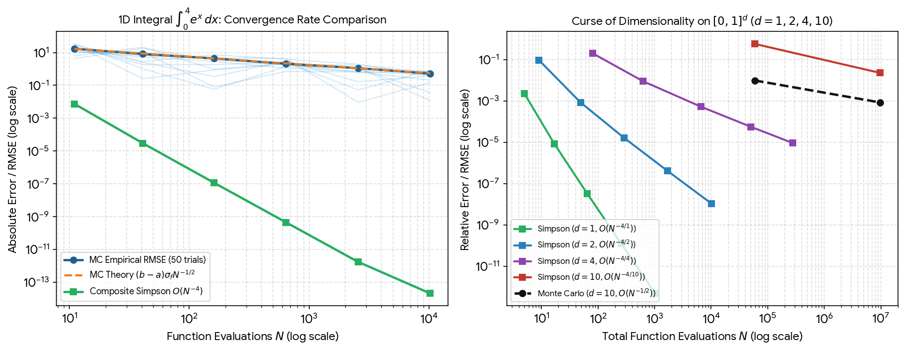

# Monte Carlo Integration & High-Dimensional Curse of Dimensionality

A numerical analysis and probability benchmark comparing **Crude Monte Carlo integration** against **Composite Simpson's Rule** across 1D and high-dimensional domains ($d \in \{1, 2, 4, 10\}$).

## Theoretical Derivation

### 1. Unbiasedness and $O(N^{-1/2})$ Convergence Rate
For i.i.d. uniform samples $X_1, \dots, X_N \sim U[a, b]$, define $Q_N = \frac{b-a}{N}\sum_{i=1}^N f(X_i)$ and $I = \int_a^b f(x)\,dx$.
- **Unbiasedness**: Since $p(x) = \frac{1}{b-a}$ on $[a,b]$, $\mathbb{E}[f(X_i)] = \frac{1}{b-a}\int_a^b f(x)\,dx = \frac{I}{b-a}$, giving $\mathbb{E}[Q_N] = I$.
- **RMSE Rate**: With $\sigma_f^2 = \mathrm{Var}(f(X_1)) < \infty$, independence yields
  $$\mathrm{RMSE}(Q_N) = \sqrt{\mathbb{E}[(Q_N - I)^2]} = \sqrt{\mathrm{Var}(Q_N)} = \frac{(b-a)\sigma_f}{\sqrt{N}} = O(N^{-1/2}).$$

### 2. Why Monte Carlo Wins in High Dimensions
A tensor-product Composite Simpson grid with $n$ subintervals per axis uses $N = (n+1)^d$ evaluations ($h = O(N^{-1/d})$), degrading its convergence rate from $O(h^4)$ to **$O(N^{-4/d})$**. Once $d > 8$, $4/d < 1/2$, so Monte Carlo's dimension-independent $O(N^{-1/2})$ rate strictly outperforms deterministic quadrature.

## Experimental Results

### Part A: 1D Benchmark $\int_0^4 e^x\,dx = e^4 - 1 \approx 53.598150$ (50 Independent Trials)

| Evaluations $N$ | Composite Simpson Error | MC Empirical RMSE | MC Theoretical RMSE |
| :---: | :---: | :---: | :---: |
| 11 | `7.480e-03` | `1.704e+01` | `1.675e+01` |
| 41 | `2.974e-05` | `8.156e+00` | `8.677e+00` |
| 161 | `1.163e-07` | `4.366e+00` | `4.379e+00` |
| 641 | `4.544e-10` | `2.077e+00` | `2.195e+00` |
| 2,561 | `1.776e-12` | `1.120e+00` | `1.098e+00` |
| 10,241 | **`2.132e-14`** | `5.239e-01` | `5.490e-01` |

### Part B: High-Dimensional Crossover on $[0, 1]^d$ ($f(\mathbf{x}) = \prod_{k=1}^d \frac{\pi}{2}\sin(\pi x_k)$, Exact $= 1$)

| Dimension $d$ | Grid Subintervals / Axis | Total Evaluations $N$ | Tensor Simpson Error | Monte Carlo RMSE |
| :---: | :---: | :---: | :---: | :---: |
| $d = 1$ | 1,024 | 1,025 | **`4.921e-13`** | `1.528e-02` |
| $d = 2$ | 100 | 10,201 | **`1.082e-08`** | `7.064e-03` |
| $d = 4$ | 14 | 50,625 | **`5.669e-05`** | `5.256e-03` |
| **$d = 10$** | **2** | **59,049** | `5.859e-01` (58.6%) | **`9.935e-03`** (**59$\times$ more accurate**) |
| **$d = 10$** | **4** | **9,765,625** | `2.303e-02` (2.30%) | **`8.567e-04`** (**27$\times$ more accurate**) |



## Usage

```bash
pip install -r requirements.txt
python monte_carlo_benchmark.py
```
